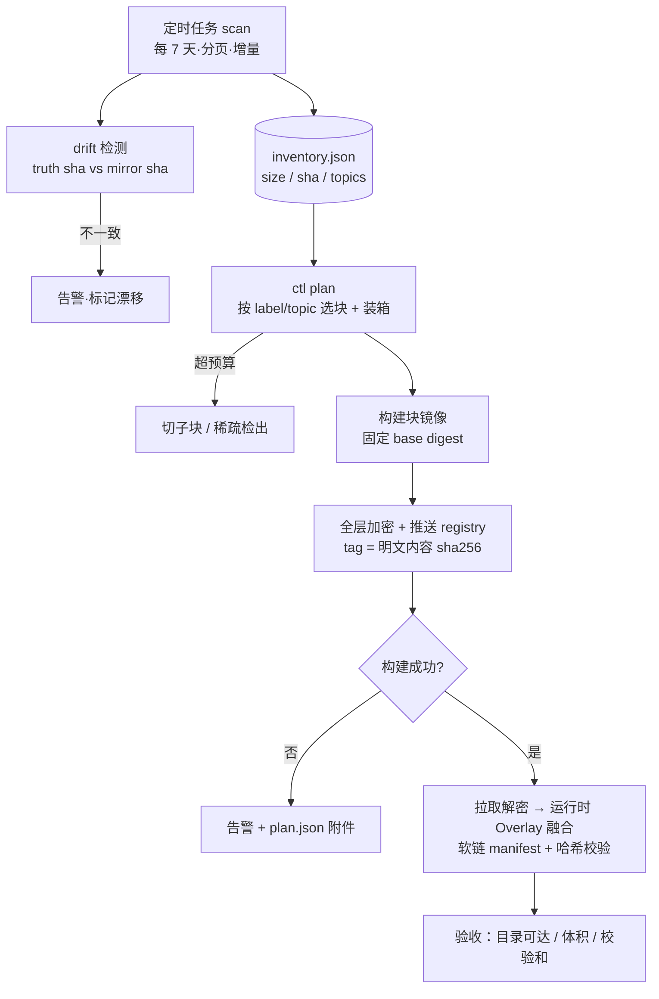

# 方案总览（完整方案拆解）

| 文档编号 | DSH-PLAN-001 |
|---|---|
| 版本 | 1.0.6 |
| 日期 | 2026-11-28 |
| 状态 | 已确认（关键参数已由需求方确认，见 §5） |
| 来源 | 《方案三：repo 多仓库「分层镜像 + 低频探测 + 标签编排」同步方案》（需求方提供，538 行） |

**修订历史**

| 版本 | 日期 | 说明 |
|---|---|---|
| 1.0.0 | 2026-11-27 | 依据需求方参考方案拆解成文；4+1 关键参数经需求方确认 |
| 1.0.1 | 2026-11-27 | 目录隔离：本文档族迁入 `solutions/repo-mirror-sync/docs/`（多方案仓库结构，见仓库根 README/AGENTS）；正文条款内容不变 |
| 1.0.2 | 2026-11-27 | §9.1 size_class 阈值（200MB/1.5GB/3.5GB，值不变）落入 `config/scan.yaml`，满足策略唯一出处（AGENTS §3.3） |
| 1.0.3 | 2026-11-28 | §12.2/§18 状态修正：阶段 3 漂移检测 `tools/detect_drift.py` 已交付（SC-M6-01~06 绿灯）；§12.3 合并裁决仍待执行 |
| 1.0.4 | 2026-11-28 | §3 术语表 L0 描述修订与 §13.1 补融合验收路径注（ADR-011 融合验收非特权化；重大变更先行） |
| 1.0.5 | 2026-11-28 | §18 阶段表行 0/2/4 状态更新：扫描链路最小集 CI 实测（ADR-013）、绑定表 fail-fast 交付、融合验收 CI 实测（ADR-012 根级化）；导出与制品链仍待执行 |
| 1.0.6 | 2026-11-28 | §18 阶段表行 0/4 状态更新：首版清单 CI 产出并经 F-9 修复复核（head_sha 填充）；拉取解密与消费侧挂载本地实测（验收记录 20261128-ci-restore，T1~T7）；导出与真实仓库清单维护仍待执行（阶段 5） |

---

## 1 范围

本文档完整拆解「repo 多仓库分层镜像同步方案」，规定方案目标、结论、需求全景映射、六大核心机制（体积清单、体积预算、分类编排、组合求解、镜像分层、运行时融合）、双变更源裁决、隐患对策、端到端流水线与落地阶段。本文档是架构设计（DSH-PLAN-002）与需求规格（DSH-PLAN-003）的上位文档。

**适用对象**：manifest 管理（`repo`）下的全部仓库的镜像同步、切片、融合与治理。

## 2 规范性引用文件

无规范性引用。资料性引用见 docs/02 §2 与 docs/03 §2。

## 3 术语和定义

| 术语 | 定义 |
|---|---|
| 块（block） | 一个可独立拉取/构建/推送的镜像单元，由 `policy.yaml` 的 `blocks` 定义 |
| 组合（combo） | 若干块的预置集合，运行时融合为一个跨目录视图 |
| 清单（inventory） | `out/inventory.json`：全仓库体积/哈希/标签唯一真相表 |
| 绑定表（bindings） | 块镜像构建时产出的 `bindings.json`，记录该块依赖的 manifest 条目 |
| 漂移（drift） | 上游真实 HEAD 与 mirror 侧 HEAD 不一致的状态 |
| 选举规则（precedence） | Overlay 融合时同名路径权威版本的裁决顺序（ADR-005） |
| 隔离区（quarantine） | 合并裁决中不满足一致性校验的补拉包的暂存目录，不进入发布镜像 |
| L0 / 工具链层 | 仅含 git/age 工具的基础镜像层，固定 digest（overlayfs 挂载由消费侧内核承担，ADR-011） |
| `lowerdir` | OverlayFS 只读下层数组，靠左优先级更高 |
| size_class | 由 inventory 自动派生的体积分级：small(<200MB)/medium/large(>1.5GB)/oversized(>3.5GB) |

## 4 方案概述（结论先行）

1. **不要每次实时探测体积**：独立低频任务（每 **7 天**，ADR-002）扫描全仓库大小/哈希，写入唯一真相表 `inventory.json`；日常 CI 只读该表，零 API 消耗。
2. **不要打一个巨型镜像**：先做「只跟 master 的 manifest 索引基础镜像」，再按 topic 出切片镜像，最后在**运行时**用 OverlayFS 融合，不在构建时把十份代码复制进一个镜像。
3. **不要靠 manifest 判断变化**：manifest 不变而 mirror 内容变是真实存在的坑，用低频任务的真实 commit 哈希比对兜底，只触发受影响的 topic。

## 5 已确认决策参数

原方案 §15 留有 4 个待确认参数，另含需求方明确提出的选举规则；**2026-11-27 需求方已逐项确认**：

| # | 参数 | 确认值 | 影响 | 决策编号 |
|---|---|---|---|---|
| D1 | 扫描周期 `every_days` | **7 天** | 漂移容忍窗口与配额消耗的平衡点 | ADR-002 |
| D2 | 单 job 预算 `budget_bytes` | **4 000 000 000（4.0 GB）** | 决定切块粒度与 job 数量 | ADR-003 |
| D3 | 加密策略 | **全层加密**（否决「仅最终层加密」建议） | 接受增量复用受限（原 H7），缓解措施见 §14 与 ADR-007 | ADR-007 |
| D4 | 融合布局 | **混合**：self-dev 扁平 / 跨 topic 组合前缀 | 兼顾 `repo sync` 兼容与同名隔离 | ADR-006 |
| D5 | 选举规则 | **toolchain > self-dev > k8s > edge**；`manifest/**` 固定 pin toolchain；`**/build.sh` 类前缀隔离 | 同名路径裁决唯一依据 | ADR-005 |

四项参数定值后，`policy.yaml` 一次性写死（见 `config/policy.yaml`），后续只改策略不改代码。

## 6 需求全景映射

原始诉求 R1～R17 与方案落点的映射（需求条目化见 docs/03）：

| 编号 | 原始诉求 | 方案落点（本文档条款） |
|---|---|---|
| R1 | 单次流水线存储上限 5 GB，k8s 类单仓可能吃满 | §8 体积预算 + §9 切片 |
| R2 | 拉代码**之前**就要知道体积，做分层 | §7 离线体积清单 |
| R3 | 按 manifest 标签分类：只拉自己开发的那块 | §9.1 标签策略 |
| R4 | 不每次探测体积，写成脚本分类 | §7 + §9.2 |
| R5 | tag/topic/单仓库均可作为分类维度 | §9.2 `policy.yaml` |
| R6 | 干活只拉对应类别标签，不拉全量 | §9.3 按策略选块 |
| R7 | 两三个大块能组合成较全仓库 | §10 组合求解 |
| R8 | 10 个 topic 镜像放同一 Docker 跨目录访问 | §13.1 运行时融合 |
| R9 | 两镜像同名目录冲突 | §13.2 冲突矩阵 |
| R10 | 内容完全一样怎么办 | §13.2 A 类规则 |
| R11 | manifest 公共目录大家都有 | §13.5 软链 + 哈希校验 |
| R12 | 先做只更新 master 的基础 Dockerfile | §11.1 索引层 |
| R13 | 基础层每次变导致全量重建 | §11.2 固定 digest + 索引出镜像进卷 |
| R14 | 怎么判断 A/B 受差异影响 | §11.3 绑定表 diff |
| R15 | manifest 没变但仓库实际变了 | §12.2 漂移检测 |
| R16 | manifest 变与漂移补拉同时到达 | §12.3 合并裁决 |
| R17 | Actions 缓存 10 GB、API 限流隐患 | §15 隐患清单 H1/H2 |

## 7 体积清单（inventory）：唯一真相表

### 7.1 设计原则

1. **单一数据源**：所有策略、流水线、告警只读 `out/inventory.json`，不二次调 API。
2. **低频**：每 7 天一次（D1 确认值），错开整点，避开日常 CI 配额高峰。
3. **增量**：只对 `last_sha` 变化的仓库重算大小，未变行原样复用。
4. **可分页/分批**：单次运行限定最大请求数（默认 200 次），跑不完写 `cursor` 下次续跑，天然抗限流。
5. **不追求字节级精确**：GitHub `size` 字段（KB、含历史对象）仅作上界估算，预算内留安全边际（§8.2）。

### 7.2 表结构（`inventory.json` 字段定义）

| 字段 | 类型 | 说明 |
|---|---|---|
| `repo` | string | 仓库全名 `owner/name` |
| `topics` | string[] | GitHub topic |
| `labels` | string[] | 自定义标签（`self-dev`/`vendor`/`k8s-heavy` 等） |
| `default_branch` | string | 用于取 HEAD |
| `size_kb` | int | API `size`，KB |
| `size_bytes_est` | int | `size_kb × 1024`（按 git 对象估算） |
| `lfs_bytes` | int | LFS 单独统计（体积爆炸主因） |
| `head_sha` | string | 采样时刻默认分支 HEAD |
| `head_sha_at` | datetime | 上次确认时间 |
| `path_in_manifest` | string | manifest 中的 `path`，用于冲突判定 |
| `shared_paths` | string[] | 该仓库贡献的公共目录（如 `manifest/`） |
| `last_scanned` | datetime | 上次扫描 |
| `scan_status` | enum | `ok / pending / error / oversized` |
| `mirror_sha` | string | mirror 侧实际 HEAD（漂移检测用） |

### 7.3 扫描逻辑要点

1. 先比对 `head_sha` 再算体积：绝大多数仓库一次请求即跳过，配额消耗 ≈ 1 次/仓库/周期。
2. 预算耗尽即保存 cursor 中断；同步产出人读版 `out/inventory.csv`。
3. 正式实现为 `tools/scan_inventory.py`（阶段 0/1，**待执行**）。

## 8 体积预算与 5 GB 红线

### 8.1 预算公式

```
budget_raw = (limit − overhead) / k
```

- `limit` = 5 GB（平台单次存储上限，配置项 `limits.storage_gb`，不硬编码）
- `overhead` = 基础层 + manifest + 构建缓存 + 日志，实测约 0.3～0.5 GB
- `k` = 安全系数 **1.25**（覆盖 git 对象与工作区膨胀、LFS、加密体积）

### 8.2 确认值与理由

单块原始代码预算确认取 **4.0 GB**（D2），超出即视为必须切分。留边距理由：

1. API `size` 为 KB 取整且只统计默认分支可达对象，与工作区实测可能不匹配；
2. 加密使数据近似不可压缩，后置 tar.gz 压缩收益趋零；
3. k8s/kernel/chromium 类单仓 2～5 GB，属「必然超限」名单，走 §9.4 特殊策略。

## 9 分类与编排策略

### 9.1 标签体系（三个正交维度）

| 维度 | 取值示例 | 用途 |
|---|---|---|
| `label`（自定义） | `self-dev` / `vendor` / `third-party` | 表达「谁的活」，`self-dev` 保证 < 预算，整块直拉 |
| `topic`（GitHub） | `k8s` / `edge` / `toolchain` | 表达「干什么活」，镜像切片边界 |
| `size_class`（派生） | small(<200MB) / medium / large(>1.5GB) / oversized(>3.5GB) | inventory 自动打标，控制是否拆分 |

派生标签由脚本维护，人工只维护前两个维度。

### 9.2 策略集中（`policy.yaml`）

所有块定义、组合、加密、选举规则、告警集中在 `config/policy.yaml`（改策略不改代码）。初始基线随本规划入库，内容与 §5 决策参数一致。

### 9.3 选块调度

统一入口 `ctl`（阶段 1 实现，**待执行**）：

```
./ctl plan --block block-self            # 日常：只拉自己的活
./ctl plan --combo full-reading          # 查全量：多块组合
./ctl plan --topics k8s,edge --budget 4G
```

`ctl plan` 先出计划（要拉哪些仓库、预估体积、是否超限、超限切几个 job）**再拉代码**，满足 R2。

### 9.4 超大单仓（k8s 类）

单仓 > 预算时按「路径」切：

1. `git clone --filter=blob:none --depth=1` 取树结构（几十 MB 级）；
2. `git sparse-checkout set <需要的目录>`；
3. 只把稀疏目录打进镜像；全量历史留 `--mirror` 冷备在对象存储（不进 CI）。

语义是「拿得起」而非「全量塞进去」，因此无需为 k8s 单独开巨大配额。

## 10 组合求解（装箱）

`ctl plan --combo` 是带上界的装箱问题：

- 输入：块列表 + 各自 `size_est` + `budget_raw`；
- 输出：`bins`（若干 job），每 bin ≤ 预算，块尽量少跨 bin；
- 算法：按 `size_class` 降序 first-fit-decreasing；块数 > 8 再上动态规划，块少时暴力枚举更稳。

约束两条：

1. **单块不可跨 job**（否则同一份代码拉两遍）；
2. **共享目录的块尽量同 bin**（减少 §13 融合冲突面）。

## 11 镜像分层：解决「基础层一变全重建」

### 11.1 索引层（L0）

只拉 manifest 仓库 master，不带子仓代码，产物 `manifest-index:<master-sha>`，几十 MB。
**镜像 tag 用 master SHA 而非 `latest`**：每次 master 变化产出新 tag，旧 tag 永久保留可回指——这是缓存可复用的前提。

### 11.2 缓存策略：索引不在镜像里，放运行时卷（选型 B）

Docker 缓存失效沿层传递，L0 digest 变化会连带 L1/L2 全部 miss，故各块镜像**不以索引镜像为 `FROM`**：

| 做法 | 结构 | 缓存行为 | 结论 |
|---|---|---|---|
| (A) 各块独立 `FROM alpine`，索引内容经 `COPY --from`/挂载引入 | 块与索引无继承关系 | 仅真正依赖索引的 COPY 层失效 | 可行 |
| (B) **索引出镜像、进运行时卷**：L0 只提供工具链（git/age/overlayfs），索引由 CI 产物 `manifest-index.tar` 上传对象存储，运行时挂载 | L0 几乎不变 | L0 稳定 → L1/L2 缓存长期命中 | **采用** |

(B) 收益：manifest 每天变十次也碰不到任何代码层缓存；代价是多一个制品下载步骤（秒级）。

### 11.3 绑定表 diff：判断 A/B 是否受影响

每块构建时写 `bindings.json`（块名 + 依赖的 manifest 条目 path/rev/sha + digest）。
判定逻辑（不扫全量、不拉代码）：`changed = diff(old_manifest, new_manifest)`（纯文本比对，毫秒级）；`hit = changed ∩ block.bindings.repos` 非空的块才进重建队列。

## 12 双变更源与冲突裁决

### 12.1 变更来源判定矩阵

| # | manifest | mirror/真实仓库 | 触发动作 | 发现机制 |
|---|---|---|---|---|
| 1 | 变 | 变 | 按新 manifest 重建受影响块 | 绑定表 diff |
| 2 | 变 | 未变 | 重建受影响块（rev 变更） | 绑定表 diff |
| 3 | **未变** | **变** | 补拉 + 打「漂移」标记，不重建其他块 | §12.2 漂移检测 |
| 4 | 未变 | 未变 | 无动作 | — |

第 3 行即「repo sync 只认 mirror，mirror 不变但真实仓库已改」——`repo sync` 不会主动报告，只有外部哈希比对能发现。

### 12.2 漂移检测（低频任务的一部分）

只比 sha 不下载内容：对每个仓库取上游真实 HEAD sha 与 mirror 侧 `ls-remote` HEAD sha 比对，不一致则发 `drift` 事件，写回 `inventory.json` 的 `mirror_sha`，告警提示 `repo sync --force-sync` 或刷新 mirror。实现为 `tools/detect_drift.py`（阶段 3，**已交付**：SC-M6-01~06 绿灯；端到端实测待真实 mirror 环境）。

### 12.3 合并裁决（顺序固定，不做「谁后到谁赢」）

1. **先按 manifest 重建**（取得正确 rev/sha 基线）；
2. **再漂移补拉**，校验补拉 sha 与第 1 步基线：一致 → 丢弃补拉包只记合并日志；不一致（mirror 落后于 manifest 指定 rev）→ **以 manifest 为准**，补拉包降级进 `quarantine/` 隔离区待人工确认，不进入发布镜像；
3. **内容级去重**：合并前对同路径文件算 `sha256`，一致则硬链（`ln`），不一致按 §13.2 矩阵处理。

效果：两份包同时到本地不会产生双版本，最坏情况进隔离区，不会悄悄覆盖。

## 13 运行时融合：一个容器访问多个 topic

### 13.1 构建时合并 vs 运行时融合

| 方案 | 体积 | 冲突面 | 结论 |
|---|---|---|---|
| 构建时 `COPY` 合并 10 镜像 | 10 份之和，必超 5 GB | 高，同名目录必撞 | ✗ |
| **运行时 OverlayFS**（`lowerdir` 多层挂载） | 各层独立 | 低，优先级可控 | ✓ 采用 |
| 单独 `FROM` 单块镜像 | 小 | 无 | 单块场景 |

10 个镜像**不合并成一个镜像**：需要的是「一个能同时看见 10 份代码的容器」；各层镜像独立推送、独立缓存、独立回滚。`lowerdir` 靠左优先级更高，即「同名目录谁赢」的开关。

融合验收路径（ADR-011）：CI 与本地验收采用**非特权用户态等价校验**（`tools/fuse_verify.py`，复用 §13.3 选举规则唯一实现 `tools/overlay.py`）；内核 OverlayFS 挂载属消费侧运行时语义，不作 CI 门禁。

### 13.2 同名目录冲突矩阵

| 情况 | 例子 | 判定 | 处理 |
|---|---|---|---|
| A 类：路径同、内容**完全一致** | 各 topic 共用同一 `vendor/` | 文件级 sha256 全同 | 只保留一份（硬链/单层），Overlay 显示最上层那份 |
| B 类：路径同、内容**不同** | `manifest/`、`build.sh`、`.gitmodules` | sha 不同 | 按 §13.3 选举规则 pin / 前缀隔离 |
| C 类：路径同、**目录结构不同** | 两个 `docs/` 子目录不同 | 目录差异 | 默认 merged（可见并集）；严格隔离用 `redirect_dir=on` 或前缀方案 |

### 13.3 选举规则（D5 确认）

从左到右优先级递减：**toolchain > self-dev > k8s > edge**。

| 规则 | 处理 |
|---|---|
| `manifest/**` | pin toolchain（公共索引永远用 toolchain 层，融合前软链指向唯一权威层，物理只有一份） |
| `**/.gitmodules` | pin self-dev |
| `**/build.sh` 类各 topic 自有脚本 | `isolate: true` 走前缀隔离 |

`pin` 的路径在融合前软链指向唯一权威层，不会出现「看似一个目录、实际两份内容」。

### 13.4 目录布局（D4 确认：混合）

```
扁平（self-dev 单块，repo 原生布局友好）：
/opt/src/
├── manifest/ -> /authority/manifest
├── k8s/...
└── edge/...

前缀（跨 topic 组合，隔离最彻底）：
/opt/src/
├── topic-k8s/...
├── topic-edge/...
└── manifest/ -> /authority/manifest
```

由 `policy.yaml` 的 `overlay.layouts` 配置切换：`self-dev` 扁平，组合前缀。

### 13.5 公共 `manifest/` 目录

融合层构建时：`COPY --from=manifest-index` 把 manifest 置于 `/authority/manifest` 并去写权限；各 topic 层如自带 `manifest` 目录则删除并软链到权威目录。配套校验**进 CI、失败即阻断**：所有软链 `readlink -f` 解析后唯一，且 `manifest.xml` 哈希与 `manifest.sha` 一致。

收益：索引只有一份、全目录视图一致、体积不重复、`repo sync` 不会被各层旧 manifest 打架。

## 14 加密策略（D3 确认：全层加密）

决策与后果（完整论证见 docs/02 ADR-007）：

1. **边界**：所有交付镜像/制品**全层加密**（age）存储于 registry/对象存储；运行时拉取后**先解密再作为 `lowerdir` 挂载**，Overlay 语义不受影响；CI 内部构建中间态不属交付边界。
2. **已接受的后果（原隐患 H7）**：age 加密非确定性，同内容加密后字节不同 → registry 内容寻址去重失效、加密层不可差分；跨构建的复用完全依赖绑定表 diff 限定重建范围 + Actions cache 预算（H1 对策）。
3. **缓解**：镜像 tag 使用**明文内容 sha256** 保持逻辑身份与可回滚性；缓存按 `cache_gb` 预算 + LRU 清理，只保留最近 N 块 × 2 版本。

## 15 隐患清单与对策

| # | 隐患 | 触发条件 | 对策 | 级别 |
|---|---|---|---|---|
| H1 | Actions 缓存 10 GB 上限被挤爆 | 多分支×多块×加密层堆积 | `cache_gb` 预算；构建后 LRU 清理只留最近 N 块×2 版本；加密层进 artifacts 不进 cache | 高 |
| H2 | API 限流（未认证 60/h，认证 5000/h，搜索 30/min） | 全量探测、逐仓查 commit | `max_requests_per_run` + cursor 续跑；先比 sha 再算体积；fine-grained token 多 token 轮转 | 高 |
| H3 | 5 GB 判断失真 | git 对象 vs 工作区差异、取整、LFS 未计 | 安全系数 1.25 + `oversized` 强制稀疏检出；告警同时给「估算/实测」双数 | 中 |
| H4 | mirror 静默漂移 | `repo sync` 只认 mirror | §12.2 低频真实 sha 比对 + 告警 | 高 |
| H5 | manifest 与 mirror 版本打架 | 两者都有更新 | §12.3 固定顺序 + manifest 为准 + 隔离区 | 中 |
| H6 | 同名目录双版本 | 多 topic 都带 `manifest/`、`build.sh` | §13.2 矩阵 + 软链 + 哈希校验阻断 | 中 |
| H7 | 加密镜像无法增量 | 整块加密 | **D3 已确认接受**；缓解见 §14（内容哈希 tag + LRU + 绑定 diff 限域） | 已接受 |
| H8 | 浅克隆拿不到历史，回溯困难 | 排障要 `git log` | mirror 侧保留完整 `--mirror` 冷备；镜像只放工作区 | 低 |
| H9 | Overlay 层数过多（内核上限约 128） | topic 越拆越细 | 按 combo 定义融合集合，单次 ≤ 8 层；超出两级融合 | 低 |
| H10 | 告警风暴 | 漂移/超限同时触发 | `alert.throttle`（1h）+ 按 kind 聚合单 issue | 低 |
| H11 | 策略改动无审计 | 直接改脚本 | 策略只在 `policy.yaml`；每次 plan 输出 `plan.json` 存档 | 低 |

## 16 端到端流水线



每个 job 开头先跑 `ctl plan`，输出示例：

```
块 block-k8s: 12 repos, 3.2 GB, 单 job 可容纳 ✓
块 block-self: 6 repos, 1.4 GB ✓
组合 full-reading: 4.6 GB > 4.0 GB 预算 → 拆为 2 job (k8s / edge+self)
```

**超限不静默失败**：按 §9.4 自动降级并发通知，符合 R17。

## 17 方案对比（备选路线否决理由）

| 维度 | 单镜像全量 | 按 topic 出镜像（本方案） | 每仓一镜像 |
|---|---|---|---|
| 5 GB 适配 | ✗ 必超 | ✓ 可预算可切 | ✓ 但镜像数量爆炸 |
| 缓存复用 | 差（任何变更全重建） | 好（块级独立） | 最好 |
| 组合灵活性 | 无 | 高（combo） | 中 |
| 运维复杂度 | 低 | 中 | 高 |
| 全量查阅体验 | 好 | 好（Overlay 融合后同体验） | 差 |
| 结论 | 否决 | **采用** | 仅超大单仓例外（§9.4） |

## 18 落地阶段（每步可验证）

| 阶段 | 工作量 | 内容 | 验收准则 |
|---|---|---|---|
| 0 基线 | 0.5 天 | 建 `config/scan.yaml`、`config/policy.yaml`；导出 manifest 仓库列表（**待执行**，阶段 5）；CI 已按 `config/scan.yaml` scan.repos 最小集实测扫描链路并产出首版清单（2026-11-28，ADR-013；F-9 修复后 head_sha 已填充，run4 复核） | 能回答：哪些仓库 >1.5GB、>3.5GB、self-dev 标签占多少 |
| 1 计划器 | 1 天 | `ctl plan` 支持 `--block/--combo/--topics/--budget`；输出 `plan.json`（**待执行**） | `plan --combo full-reading` 自动拆出不超预算 job 列表 |
| 2 索引层与块镜像 | 1~2 天 | `manifest-index` 用 SHA tag；块镜像 FROM 工具链镜像而非索引镜像；`bindings.json` 随镜像产出（**已交付**：流水线内生成验证绑定表 + 镜像内 fail-fast 校验；真实绑定表内容由扫描与 plan 产出=阶段 5） | manifest 改一个仓库 → 仅 1 块重建，其余命中缓存（CI 日志 CACHED） |
| 3 漂移与合并 | 1 天 | 低频任务加入 sha 比对（**已交付**：`tools/detect_drift.py`，SC-M6-01~06 绿）；合并裁决按 §12.3（**待执行**） | 手动回退 mirror 一个 commit，下一周期报漂移且只补拉 1 块（报漂移行为已由 SC-M6-02 注入式覆盖，端到端实测待执行） |
| 4 融合与验收 | 1 天 | Overlay 启动脚本 + manifest 软链 + 非特权融合校验 + 加密往返哈希门禁（**已交付**并 CI 实测）；拉取解密已用 CI 制品本地实测（T2/T3），消费侧挂载已容器自验（T6，ADR-011 语义不变）；schedule/dispatch 与真实仓库清单维护待合 main 后收口（**待执行**，阶段 5） | 单容器 `ls` 可见全部 topic；`find -type l` 显示 manifest 唯一；两份不同 `build.sh` 按规则隔离非覆盖 |
| 5 告警与治理 | 0.5 天 | 四类告警接入 issue/webhook，1h 节流；缓存 LRU 清理（**待执行**） | 人为制造超限，1 分钟内收到一条可行动通知 |

## 附录 A（资料性）

本文档内容拆解自需求方提供的参考方案《方案三：repo 多仓库「分层镜像 + 低频探测 + 标签编排」同步方案》，该文件注明部分内容由豆包 AI 生成；D1～D5 参数由需求方于 2026-11-27 会话确认。
